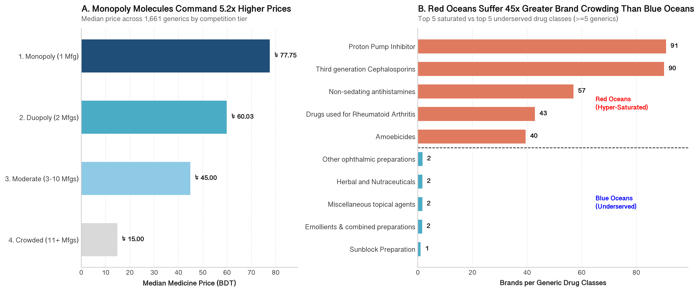

# Bangladesh Pharmaceutical Market Analysis

Just 50 of **232 manufacturers** hold **74.2%** of Bangladesh's **21,712 registered medicine brands**. This Python analysis maps where the market is crowded, where it is underserved and how competition shapes prices.

[](https://akhunjee.dev/projects/pharma-market-analysis-bd)
[](https://www.kaggle.com/code/nbakh16/bangladesh-pharma-market-eda-pricing-strategy/)



## Key Findings

* **A top-heavy market:** The top 50 manufacturers (21.5% of firms) hold **74.2% of registered brands**. The top 10 dominate complex dosage forms such as inhalation capsules (71.6%) and extended-release tablets (53.4%), while small producers cluster in liquids and capsules.
* **Prices are tightly anchored:** Across 347 comparable drug cohorts, the middle 50% of brands differ by a median of just **1.09x**. Small manufacturers price **36.3%** of their products below the cohort median, nearly 3x the rate of the top 10 (13.1%).
* **Competition sets the price:** Median prices climb from **৳15.00** in crowded generics (11+ manufacturers) to **৳77.76** in monopolies, about **5.2x**. Just 18.5% of generics account for 74% of all brands.
* **White space exists:** 50 registered generics have no active brands. Antidotes, antiparkinson drugs and contrast media look like the most viable commercial gaps.

---

## Repository Structure

```text
├── data/
│   ├── raw/                                  # Original datasets
│   └── processed/
│       ├── master_medicines.csv              # Cleaned baseline dataset (21,712 brands)
│       ├── master_medicines_enriched.csv     # Enriched dataset with strategic tiers for dashboard
│       └── unmanufactured_generics.csv       # 50 registered generics with 0 manufactured brands
├── notebooks/
│   ├── 01_data_cleaning_and_schema.ipynb     # Data cleaning, price parsing and validation
│   ├── 02_exploratory_market_analysis.ipynb  # Core statistical analysis
│   └── 03_market_visualizations.ipynb        # Executive Charts
├── reports/
│   └── figures/                              #  Charts in PNG format
└── README.md
```

## Run it Yourself

```bash
git clone https://github.com/nbakh16/pharma-market-analysis-bd.git
cd pharma-market-analysis-bd
pip install -r requirements.txt
jupyter notebook
```

Run the notebooks in order (01 → 02 → 03).

## Tools

Python (Pandas, NumPy, Matplotlib), Jupyter Notebook / JupyterLab


## Data Source

[Assorted Medicine Dataset of Bangladesh](https://www.kaggle.com/datasets/ahmedshahriarsakib/assorted-medicine-dataset-of-bangladesh) on Kaggle, which compiles public registry data from Medex.com.bd. Created for educational and portfolio purposes only, not medical advice.

## Read the Full Story

The case study covers the full analysis, the supporting tables and charts, business recommendations and limitations:

**[Read the full case study](https://akhunjee.dev/projects/pharma-market-analysis-bd)**

## License

This project is licensed under the [MIT License](LICENSE).

---
**Nabil Akhunjee** · Data & Business Analyst · [Portfolio](https://akhunjee.dev/) · [LinkedIn](https://www.linkedin.com/in/nbakh16/)